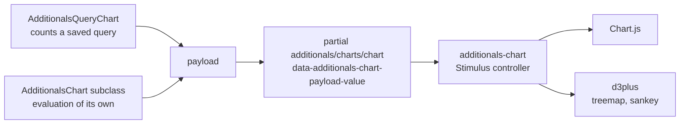

# Chart Development Guide

Every chart of `additionals` and the plugins built on it is drawn the same way: a Ruby class returns the data as a payload, the `additionals-chart` Stimulus controller draws it with Chart.js or d3plus. Views contain no chart JavaScript. For dashboard blocks in general see the [Dashboard Development Guide](dashboards.md).



There are two ways to a chart:

| Way | Use it for | Example |
| --- | ---------- | ------- |
| [Query chart blocks](#query-chart-blocks) | how the entries of a query spread over the values of a column | issues by tracker, hours by project |
| [Charts with an evaluation of their own](#charts-with-an-evaluation-of-their-own) | anything a grouped query cannot answer | a burndown, activity per week, a hierarchy |

## Charts With an Evaluation of Their Own

Subclass `AdditionalsChart` and implement `payload` and `valid?`:

```ruby
class WikiActivityChart < AdditionalsChart
  def payload
    @payload ||= { type: 'area',
                   labels: ['KW 41/2026', 'KW 42/2026'],
                   datasets: [{ label: l(:label_wiki_pages_added), data: [3, 5], urls: [nil, '/projects/foo/activity'] }],
                   totalLabel: l(:label_quantity),
                   colorSchema: color_schema }
  end

  def valid? = payload[:datasets].any? { |dataset| dataset[:data].any?(&:positive?) }
end
```

The view renders the shared partial below its title; `valid?` false shows "No data":

```slim
h3.icon = svg_icon_tag chart.icon, label: :label_wiki_activities
= render 'additionals/charts/chart', chart:, id: block
```

| Method or partial | Content |
| ----------------- | ------- |
| `payload` | the data, see [Payload Reference](#payload-reference) |
| `valid?` | false shows "No data" instead of an empty chart |
| `height` | height of the chart in pixels, 350 by default |
| `icon` | icon of the title, follows the type |
| `color_schema` | the color scheme configured for charts, `tableau.Classic20` otherwise |
| `calc_bar_height(entries, groups)` | height of horizontal bars by their number |
| `additionals/charts/chart` | one chart (`chart:`, `id:`) |
| `additionals/charts/charts` | several charts side by side, below each other in a narrow column (`charts:`, `id:`) |
| `additionals/charts/key_figures` | key figures above a chart, see [Key Figures](#key-figures) |

The page or block loads the libraries: `additionals_library_load :chartjs_meta` (Chart.js with the datalabels and annotation plugins), or `libraries: %i[chartjs_meta]` in the block definition. The controller loads what only some charts need when they need it: d3plus for treemap and sankey, the matrix plugin for matrix and calendar, the annotation plugin for `lines`.

A class may answer `chart_data_present?(project:)` with one cheap `EXISTS` query; a lazy block with `data_check_class` then reserves the height of a chart (see [Async Blocks](dashboards.md#async-blocks)).

### Key Figures

`additionals/charts/key_figures` renders tiles above a chart, e.g. the total and the share that needs attention:

```ruby
def key_figures
  [{ label: l(:label_total_time), value: l_hours_short(total) },
   { label: l(:label_overdue), value: overdue.to_s, note: l(:label_x_of_y, count: overdue, total:), alert: overdue.positive? }]
end
```

| Key | Content |
| --- | ------- |
| `label` | name of the figure |
| `value` | the figure, formatted on the server |
| `note` | small text below the value |
| `alert` | red edge: needs attention |
| `success` | green edge: a goal reached |

Show a figure only where it holds: a tile without meaning (e.g. a comparison without a comparison year) is left out, not shown empty.

## Payload Reference

All texts of a payload are formatted on the server, so no translation ends up in JavaScript. Numbers without a text of the server and the axes of Chart.js are formatted in the language of the page (`lang` of `<html>`, the language of the user), not of the browser. Colors are CSS custom properties (`--oc-red-6`), read at runtime.

### Common Keys

| Key | Content |
| --- | ------- |
| `type` | `doughnut`, `pie`, `bar_horizontal`, `bar_vertical`, `line`, `area`, `treemap`, `sankey`, `matrix`, `calendar` |
| `labels` | one label per entry (category, period, tile) |
| `datasets` | the series, see [Dataset Keys](#dataset-keys) |
| `valueTexts` | per dataset the text of each value, e.g. a localized decimal or hours in the format of the user |
| `total` | the whole the shares refer to (pie, doughnut, treemap) |
| `totalLabel` | title of the values, e.g. of the value axis or below the total of a doughnut |
| `totalText` | text of the total in a doughnut, `total` otherwise |
| `colorSchema` | Chart.js color scheme, e.g. `tableau.Classic20` |

### Bars, Lines and Areas

| Key | Content |
| --- | ------- |
| `stacked` | stacks the datasets; values sit inside the parts if they fit |
| `percent` | with `stacked`, the bars are shares of 100 %; the tooltip still names the values |
| `valueLabels: false` | no values next to the bars, e.g. long amounts |
| `legend: false` | no legend, e.g. where `colors` give the bars of one dataset different colors and the legend would show only the first |
| `points: false` | no points on lines, a point still shows on hover |
| `lines` | lines across the chart with a text: `[{ axis: 'x', value:, label: }]`, e.g. today on a burndown; on a category axis a value between two entries lies between them |

### Dataset Keys

| Key | Content |
| --- | ------- |
| `label` | name of the series |
| `data` | the values; `nil` leaves a gap in a line |
| `urls` | per value the list a click opens, `nil` for none |
| `tooltips` | per value an extra tooltip line, or an array of lines |
| `colors` | per value a CSS custom property for parts with a meaning of their own (e.g. overdue in red); `nil` keeps the color of the scheme |
| `color` | one CSS custom property for a line or area |
| `type: 'line'` | in a bar chart: a line above the bars as comparison (e.g. the year before, a target), outside the stacks and shares |
| `stepped: true` | the line runs in steps between the periods, e.g. working hours per day |
| `style` | `dashed` or `dotted` line |
| `fill: true` | the area below a line, fading out towards the axis (unless stacked) |
| `onTop: true` | drawn above the others; legend and tooltip keep the order of the payload |
| `markers` | per value `best` (gold star) or `worst` (an unobtrusive ↯) above a vertical bar, above the whole stack in stacked bars; the meaning belongs in `tooltips` |

### Treemap

| Key | Content |
| --- | ------- |
| `labels` | names of the tiles, the titles of their tooltips |
| `tileLabels` | another text on the tiles, e.g. the size of a file whose name rarely fits |
| `restLabel` | name of the tile into which d3plus merges the tiles below 0.01 % (shown as "Rest < 0.01%"); it links nowhere |

d3plus adds the share as a second line on every tile; it cannot be replaced. The tooltip names value and share.

### Sankey

```ruby
{ type: 'sankey',
  sankey: { nodes: [{ id: 'root', name: 'Projects' }, { id: 1, name: 'Website', url: '/projects/website' }],
            links: [{ source: 'root', target: 1 }] } }
```

A hierarchy as flows from the left. d3plus v4 draws no node labels, the names are in the tooltip.

### Matrix

```ruby
{ type: 'matrix',
  matrix: { columns: ['Mo 13', 'Tu 14'], rows: %w[Alice Bob],
            cells: [{ x: 'Mo 13', y: 'Alice', color: '--oc-green-6', title: 'Alice, Mo 13', lines: ['8:00 h'], url: '/time_entries?...' }] } }
```

A grid of rows and columns, e.g. users by day; each cell in the CSS custom property of its category as the server chose it.

### Calendar

`calendar: { points: [{ x:, y:, v: }], weeks:, weekdays:, months:, levels:, legend: }`: the days of a year in columns of weeks, built by `AdditionalsQueryChart` for a timeline. The color levels are quantiles of the days with values, so no setting is needed for small or large numbers.

## Query Chart Blocks

A query chart block shows how the entries of a saved query spread over the values of a column, counted or summed up, as doughnut, pie, bars, line, area, treemap, calendar or table. Subclass `AdditionalsQueryChart` with the query class and the list a part links to, and let it define the block:

```ruby
class TimeEntryQueryChart < AdditionalsQueryChart
  def query_class = TimeEntryQuery

  private

  def entity_plural_label = :label_spent_time
  def custom_field_project_key = "#{TimeEntry.table_name}.project_id"

  def list_path(params)
    url_helpers = Rails.application.routes.url_helpers
    # without project on the welcome dashboard
    project ? url_helpers.project_time_entries_path(project, params) : url_helpers.time_entries_path(params)
  end
end

blocks['time_entry_chart'] = TimeEntryQueryChart.dashboard_block(label: l(:label_chart_with_name, l(:label_spent_time)),
                                                                 permission: :view_time_entries)
```

`dashboard_block` sets the async partial `dashboards/blocks/query_chart` with its settings form, the libraries, lazy loading and `max_occurs`; further options extend or replace these.

### How It Counts

- **Grouping and totals come from core** (`result_count_by_group`, `total_by_group_for`), so visibility and filters behave like the grouped list. The SQL of a column comes from the query (`group_by_statement`), so a query class that groups a column its own way is respected.
- **Custom fields with multiple values** are counted separately, since core cannot group them. An entry counts in each of its groups, but once in the total, so the total matches the linked list; the shares refer to that total and the block explains when they add up to more than 100 %.
- **A second column** (`split_by`) splits each entry into parts, shown as stacked bars or a cross table. ActiveRecord no longer turns association names into records when grouping by two columns, so the base groups by the foreign key and loads the records itself; at most one of the two columns may have multiple values.
- **A date column makes a timeline:** core groups by day (timestamps in the time zone of the user), the base sums the days up to weeks, months, quarters or years (`interval`), fills the periods without entries with 0 (up to today for dates in the past only, filter type `date_past`) and links a period with a `><` filter of its days. `max_entries` keeps the latest periods. A timeline can be shown as calendar.
- **A number column** (filter type integer, float or hour, a column of the table or a custom field) forms classes: bounds from `classes` or round steps over all values. The database groups by class (`CASE`); counts are plucked and sums taken per class, since ActiveRecord cannot read back the keys of a long grouping expression.
- **The settings form** offers only the settings that apply to the chosen column and display type (Stimulus controller `additionals-chart-settings`); for settings saved before, `chart_type` falls back the same way.
- **Descriptions:** a block may carry its own description (`description`, wiki formatted) below its title; the descriptions of its saved queries show below the chart with a link to their list.

### Hooks of a Subclass

| Hook | Content |
| ---- | ------- |
| `open_only_label` | label of the option to apply the default filters of the query class (e.g. open issues) on top of the query. Offered only with a label, a generic text could not tell what it does. The base joins both filters of a field in the link where list filters allow it; `url_filter_values` turns special operators into values (e.g. "open" into status ids), otherwise the part has no link. |
| `custom_values_visibility` | condition of the custom field values a user may see, by default via `custom_field_project_key`. Entities without a project or with several projects decide themselves. |
| `prepare_query` | adapts the query of the chart only, e.g. to count an entry once per group if the query joins repeating rows |
| `measure_columns` | the columns a chart can sum up, the totals of the list by default |
| `period_field` | the date filter a block can count in a relative period of (e.g. this month), with the previous period as comparison; `nil` offers no period |
| `default_measure` | what a block without a choice measures, a count by default; a column, e.g. the hours of time entries |
| `split_column?` | the columns a split may use; by default plain columns and custom fields, whose keys the base maps like core |

## Display

Handled in `additionals.css` and the controller, worth knowing before changing them:

- Axes, legends and titles stay in the background for every Chart.js chart: `--a-color-muted` in the font of the page at 11 px, light lines (`--a-color-border-light`) of the value axis only. Axes resolve their text against defaults of their own, so color and font are set on each axis, not only on the chart. Labels of the entries slant where they do not fit: level, a timeline of days would show only every fifth day.
- The chart and table layout of query chart blocks lives under `.additionals-query-chart`.
- Header and total of the scrolling table of values only stick with `overflow: clip` instead of core's `overflow: hidden` (which makes the table its own scroll container), separate borders and a `z-index` on `thead`/`tfoot`.
- The `clip` option of chartjs-plugin-datalabels cuts values off at the edge. Instead `layout.padding` reserves room for the longest value, values wider than their vertical bar are slanted by 45 degrees, and the legend of vertical bars sits below the chart, since the padding lies above the legend.
- Canvas knows no CSS `var()`: the controller reads custom properties with `getComputedStyle`, so a theme changes the colors of the charts as well.
- d3plus writes tooltips as HTML: the controller escapes every name, Chart.js draws on a canvas and needs no escaping.

## Testing

- **Ruby:** test the payload of a chart class, not the drawing: labels, values, texts, colors, `valid?`, key figures.
- **JavaScript:** the controller has Vitest tests in `test/javascript/controllers/additionals_chart_controller.test.js`; a new payload option gets its test there.
- **Conventions:** `assert_charts_drawn_from_payload '<plugin>'` (from the global test helper) fails as soon as a view of the plugin creates a chart itself (`new Chart(`, `new d3plus.`). Plugins with charts call it in their convention test.
