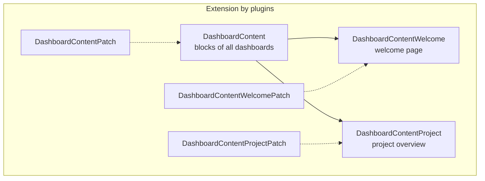

# Dashboard Development Guide

The dashboards of `additionals` replace the welcome page and the project overview of Redmine with layouts of blocks. Most plugins add blocks; new dashboard types are rarely needed. Charts in blocks are described in the [Chart Development Guide](charts.md).



## Dashboards

### Types

| Type | Class | Project | Blocks of additionals | Default layout |
| ---- | ----- | ------- | --------------------- | -------------- |
| `WelcomeDashboard` | `DashboardContentWelcome` | always `nil`, set by `dashboard_type_check` | `welcome`, `activity`, `legacy_left`, `legacy_right` | left: `welcome`, `legacy_left`; right: `legacy_right` |
| `ProjectDashboard` | `DashboardContentProject` | a project, or `nil` for all projects | `projectinformation`, `projectissues`, `projecttimeentries`, `projectmembers`, `projectsubprojects`, `legacy_left`, `legacy_right` | left: `projectinformation`, `projectissues`, `projecttimeentries`; right: `projectmembers`, `projectsubprojects` |

Blocks available on both types (news, documents, queries, feeds, text, ...) are defined in `DashboardContent`.

### System Defaults

A system default is the dashboard a user gets without a choice of their own. Which dashboard a page shows (`Dashboard.default`):

1. the dashboard the user used recently
2. the system default of the project (`system_default: true`, `project_id` set)
3. the global system default (`system_default: true`, `project_id: nil`)
4. a dashboard of the user

| Dashboard | Number allowed | Deletable |
| --------- | -------------- | --------- |
| Welcome system default | one | no |
| Global project system default (`project_id: nil`) | one | no, it is the fallback of every project |
| Project system default (`project_id` set) | one per project | yes |
| Any other dashboard | any | yes, if the user may edit it |

Rules enforced by the model:

- A system default is public (`VISIBILITY_PUBLIC`); dashboards are private, for roles or public.
- Marking a dashboard as system default unsets the other system defaults of its type, for project dashboards of the same project (`update_system_defaults`).
- A system default cannot turn back into a regular dashboard (`SystemDefaultChangeException`), the global project system default cannot get a project (`ProjectSystemDefaultChangeException`, see `project_id_can_change?`).
- Deleting a locked dashboard or one that is not `deletable?` raises an error (`before_destroy`). Dashboards of a project are destroyed with it, locked ones and private ones of other users included (`destroyed_by_association`), the global ones stay.
- A deleted user takes the private dashboards along, the other ones get the anonymous user as author, like queries in Redmine core.

### Private Dashboards and Admins

Admins see and edit every dashboard except private dashboards of other users, neither in lists nor by ID. Block settings may hold credentials such as tokens. This deliberately differs from private queries in Redmine core, which admins can open and edit by ID; core only hides them from lists.

## Blocks

### Registering a Block

A block is a class in `lib/dashboard_blocks/` of its plugin, one file per block. additionals collects the classes of all plugins (see Extension points of `redmine_plugin_kit`), a plugin declares the directory in its `init.rb`:

```ruby
loader = RedminePluginKit::Loader.new plugin_id: 'my_plugin'
loader.extends %w[dashboard_blocks]
```

```ruby
# lib/dashboard_blocks/my_block.rb
module DashboardBlocks
  class MyBlock < Base
    block_id 'my_block'
    label :label_my_block
    permission :view_issues
    no_settings!
    partial 'dashboards/blocks/my_block'
  end
end
```

The block id is stored in the layout of dashboards and never changes. Block classes are loaded at boot, also by `db:create` and `db:migrate`: name queries, charts and services as a string (`class: 'MyEntryQuery'`, `chart 'MyEntryQueryChart'`, `data_check_class: 'MyChart'`) or use them in a lambda or method, because their class body may read the database. Without `dashboards` a block is offered on every dashboard type, `dashboards :welcome, :project` limits it; a type is the name of a `DashboardContent` subclass (`DashboardContentWelcome` is `:welcome`). The block then appears in the block selection; its partial renders below the title bar of the dashboard.

What depends on the user, the project or the data is an instance method with `project`, `user` and `dashboard_content`:

```ruby
def available?
  Redmine::AccessControl.active_module? :news
end
```

A `block_definitions` method of a dashboard content stops the boot with `DashboardBlocks::PatchError`: dashboard blocks are classes only, views get the block object.

### Locals of a Block View

| Local | Content |
| ----- | ------- |
| `dashboard` | the dashboard |
| `block` | id of the block, e.g. `my_block` or `my_block__2` for a second one |
| `dashboard_block` | the block object with the stored settings: its label, its data and each declared setting typed and with its default, e.g. `dashboard_block.max_entries` |
| `settings` | the stored settings of the block (symbol keys), as forms sent them |
| `async` | the async configuration (async blocks only) |
| `@project` | the project, `nil` on the welcome page |

### Settings

A block declares its settings, so saving them validates and casts them (see [Declared Settings](#declared-settings)), and its settings form is built from them:

```ruby
class MyBlock < Base
  block_id 'my_block'
  label :label_my_block
  permission :view_issues
  partial 'dashboards/blocks/my_block'
  setting :title, **DashboardContent::TITLE_SETTING
  setting :max_entries, **DashboardContent::MAX_ENTRIES_SETTING
  setting :show_closed, type: :boolean, label: :label_show_closed
end
```

The form shows a field per setting with the existing settings fields (`additionals_settings_*`): a checkbox for `boolean`, a number field for `integer` and `float` with `min` and `max`, a text field for `string`, a text area for `text`, a select of the offered values for `enum` and a multiple select for `list`. It fills in the stored value or the default, shows a `placeholder` in an empty field (a title shows the label of the block, which the block uses without one) and marks required settings; a setting that does not apply or has no values to choose (e.g. a query select without saved queries) is left out and keeps its stored value. A setting the fields of the types cannot show names the partial of its field with `field:`, e.g. `field: 'dashboards/settings/check_boxes'` for a list as checkboxes, `dashboards/settings/url` for a URL or `dashboards/settings/wiki_text` for a text with the toolbar of the text formatting; the partial gets `setting` (as described), `value`, `tag_name` and `dashboard_block`, and belongs to the kind of field, not to the block. A setting with `secret: true` (a token, key or password) gets a password field that is never filled in: with a stored value it shows an edit icon, and the field is sent only after clicking it, so the stored value stays until then; sent blank it is removed. `export` never contains a secret setting. The form opens at the top of the block below the settings icon, for blocks rendered with the page and async blocks alike (`dashboards/blocks/settings_form`). A block whose settings the form cannot show yet (e.g. the columns of a query list, or fields that switch with another value in the open form) names its own form with `settings_partial`; the renderer raises an error for such a type instead of showing a wrong field.

A rule of a setting is a method of the block named after the setting, called with the schema (`schema[:key]` reads another setting, `project` and `user` come from the block). A lambda in `setting` is an error:

```ruby
setting :with_subprojects, type: :boolean, label: :label_cross_project_descendants

private

def with_subprojects_available?(_schema) = project.present? # if: whether the setting exists
def interval_applies?(schema) = schema[:group_by] == 'created_on' # applies
def query_id_values(_schema) = MyQuery.visible.map { |query| [query.name, query.id.to_s] } # values
```

Each setting gets a reader on the block with its typed value and default (`dashboard_block.max_entries`); a stored number out of its bounds reads as the default. A setting must not hide another method of the block, `reader:` names its reader otherwise (`setting :user, type: :string, reader: :login_user`). The fields of the settings partial are named `settings[<block>][<key>]`, the helpers of additionals build them with label and value:

```slim
.box.tabular.settings
  p = additionals_settings_textfield :title, value: dashboard_block.title, tag_name: "settings[#{block}][title]"
  p = additionals_settings_numberfield :max_entries, value: dashboard_block.max_entries,
                                                     tag_name: "settings[#{block}][max_entries]", min: 1, max: 100
  p = additionals_settings_checkbox :show_closed, active_value: dashboard_block.show_closed,
                                                  tag_name: "settings[#{block}][show_closed]"
```

A block without declarations reads `settings` itself; then read booleans with `RedminePluginKit.true?`, a checkbox sends `"0"`, which is truthy in Ruby.

### Declared Settings

A block declares its settings with `setting`, in the format of [`Additionals::SettingsSchema`](settings-schema.md). Saving them (`Dashboard#update_block_settings`) then drops unknown keys and stores nothing if a value is invalid; the settings form shows the errors. `QueryListBlock` declares the settings of its form (`query_id`, `columns`, `max_entries`, `auto_refresh`) for all query list blocks, a subclass with an own settings form declares its settings again; blocks with `no_settings!` drop every setting. Blocks without declared settings keep whatever they get.

Saving runs in this order: `settings_filter` on the given settings, then the declared settings on them, completed by the stored ones. Only given values are checked against their values and bounds, stored ones only for required settings: a query the editor cannot see or a column removed since does not lock the block. A program may send a part of the settings.

`DashboardContent#available_block_schemas` lists the blocks the user can add with `label`, `max_occurs` and their described settings, `#block_settings(block, values:)` returns the schema of one block.

### Data of a Block

A block loads what it shows in `data`, for its settings and independent of the output; its partial renders `dashboard_block.data` and fetches nothing itself. A block decides whether its data leaves the dashboard: `export_data` returns it as plain values (strings, numbers, booleans, arrays, hashes, dates as ISO 8601) for the API and AI or MCP tools, `nil` (the default) keeps it on the dashboard.

```ruby
def data
  @data ||= MyEntry.visible(user).where(project:).limit(max_entries).to_a
end

def export_data
  data.map { |entry| { id: entry.id, name: entry.name, created_on: entry.created_on.iso8601 } }
end
```

Partial and `export_data` read the same structure from the block or its model, neither builds one of its own: a table the partial assembles (columns depending on options, totals) belongs into the model, so HTML and JSON cannot drift apart. An `export_data` of more than a few lines usually rebuilds such a structure.

`QueryListBlock` provides both for all query lists (the columns of the query and a row of values per entry). `QueryChartBlock` provides both for all query charts: `data` is the chart, `export_data` its table of values with `summary`, `columns`, a row per entry and `totals`; a timeline starts its rows with the start date of each period and names its `interval`, a chart that cannot be drawn names why in `unavailable`. Sums are numbers rounded to two decimals, not the formatted values of the table. A block with a chart of its own evaluation (`AdditionalsChart`) returns `export_chart data`: what the chart draws (`payload`) with `measure`, a column per dataset and a row per label, `nil` for a chart without values. The block builds the chart in `data`; a chart that is shown outside of dashboards as well gets its construction in the chart class (e.g. `ReportingBurndownChart.for_version`), so both places share it.

`Additionals::DashboardBlockService` serves blocks without a dashboard for the current user, to the API (`DashboardBlocksController`, `/dashboard_blocks.json`, `/dashboard_blocks/<id>.json`) and to AI or MCP tools alike: `blocks` lists them, `block(id, settings:)` returns a result with `status` (`:ok`, `:not_found`, `:forbidden`, `:invalid`), `block` and `errors`. Without a project those of the welcome page plus those only other dashboard types offer, a block of several types once with the first type offering it, so its own rules apply. Unlike saving on a dashboard, which drops unknown settings, the API answers a setting the block does not have in its context with 422; given settings that do not apply to the other values are named in `settings_not_applied`, like those the `settings_filter` of the block leaves out (e.g. without a permission). A dashboard type with a restricted page of its own answers `DashboardContent.blocks_accessible?(user)`, e.g. HRM with the permission to view HRM: the API leaves out blocks only this type offers, and `Dashboard#visible?` hides its dashboards, so their blocks cannot be loaded on their own either.

The API requires a logged in user, also where Redmine requires no login: computing blocks can be expensive. Settings of the caller differ from stored ones in one way: on a dashboard only its editors set them, in the API anyone may. A block that reaches beyond the permissions of the user with its settings overrides `own_settings_allowed?` (default true) and answers 403 (`:forbidden`) otherwise. The feed block does so: the server reads its URL, so only users who may save dashboards get it with a URL of their own, like those who could set it on a dashboard. Its URL is read with http or https only, a few redirects, a timeout of a few seconds and a size limit.

`Dashboard#block_export(block, user:)` returns a block of the layout as a program reads it: `block`, `label`, the typed `settings` of the context and `data`, with `data: false` without loading the data; `nil` for a block that is not in the layout or not available to the user. The `settings` only for a user who may edit the dashboard, because stored settings can hold credentials (e.g. tokens of devops blocks). `Dashboard#layout_export(user)` returns the groups of the layout with their blocks this way, as the dashboards API shows it (`/dashboards/<id>.json`); see Assigning a Layout for blocks the user cannot use here. `Additionals::DashboardService#dashboards(project:, dashboard_type:)` lists the dashboards a user can see like the dashboard choice of a project, for the API and tools. `DashboardContent#available_block_schemas` tells with `exports_data` which blocks export their data. What the user may not see stays hidden, e.g. authors of anonymized activities.

### Async Blocks

An async block renders an empty frame first and loads its content with a request of its own, so a slow block does not hold up the page:

```ruby
class MyBlock < Base
  block_id 'my_block'
  label :label_my_block
  permission :view_issues
  async partial: 'dashboards/blocks/my_block',
        cache_expires_in: 600,
        required_settings: %i[query_id],
        libraries: %i[chartjs_meta],
        lazy: true

  # Part of the cache key, asked when the block is rendered
  def unique_params
    [MyEntry.maximum(:updated_on)]
  end
end
```

The partial wraps its content in `dashboard_async_cache dashboard, block, async, settings do ... end`, which caches it under a key of the block, its settings and the user.

**Why the cache expires by time.** Async blocks expire after `cache_expires_in` on purpose, they are not invalidated when data changes. What a block shows depends on much more than its main records: a query block also reflects time entries, journals, custom field values, memberships and permissions. Change-based invalidation would have to know all of these sources, and a missed one would leave a block wrong until the cache expires. A short TTL is wrong for seconds at most, wherever a change comes from, and returning from an entry edited via the context menu of a query list block drops the cached block.

`unique_params` (an instance method) is the cheap way to react to changes: each value becomes part of the cache key, so a new value leads to a new entry. Use values from indexed columns, because they are evaluated on every request. `MAX(updated_on)` of a table without an index on that column reads the whole table, e.g. `issues` in Redmine core.

**Why lazy loading is opt-in.** `lazy: true` loads a block when it scrolls into view. It is not the default because blocks with auto refresh must poll regardless of the viewport, toggled blocks load on a click, lazy blocks outside the viewport are missing from a printout, and without a placeholder of the final height (`data_check_class`, see the [Chart Development Guide](charts.md)) all placeholders lie in view at once and nothing is saved. Query list blocks are lazy, they render the largest data sets.

### Query List Blocks

A block listing the entries of a saved query inherits from `QueryListBlock`; additionals provides the partials, settings (query, columns, sort, number of entries) and async loading. A chart of a saved query inherits from `QueryChartBlock` and names its `AdditionalsQueryChart`:

```ruby
class MyEntryQueryBlock < QueryListBlock
  block_id 'myentryquery'
  label { I18n.t :label_query_with_name, value: I18n.t(:label_my_entries) }
  permission :view_my_entries
  query_block label: :label_my_entries,
              list_partial: 'my_entries/list',
              class: 'MyEntryQuery',
              link_helper: '_project_my_entries_path',
              entities_var: :entries,
              with_project: true
end

class MyEntryChartBlock < QueryChartBlock
  block_id 'my_entry_chart'
  label { I18n.t :label_chart_with_name, value: I18n.t(:label_my_entries) }
  permission :view_my_entries
  chart 'MyEntryQueryChart'
end
```

A list never exports the columns named in `export_without` of `query_block` (`export_data`), e.g. `%i[password description]` for encrypted values; the dashboard shows them as before.

`QueryChartBlock` declares all settings of the chart settings form. Its rules ask the chart class instead of restating it (`group_options`, `timeline?`, `calendar?`, `period_supported?`, `default_measure`, ...), so a chart class of another plugin is covered by overriding these. The chart class itself knows nothing of dashboards and keeps its own fallbacks, it is used elsewhere too (e.g. on a version). `offered` names what the form offers for the other values, e.g. no doughnut for a timeline; a stored value outside is still valid and falls back when the chart reads it.

### Block Declarations

| Declaration | Content |
| ----------- | ------- |
| `block_id` | id stored in the layout of dashboards |
| `label` | locale key, or a block for a composed label |
| `dashboards` | dashboard types the block is offered on, all without it |
| `permission` | permission(s) the user needs, a symbol or an array (all required) |
| `admin_only!` | block for administrators only |
| `partial` | view of a synchronous block |
| `async` | async loading, see below |
| `no_settings!` | the block has no settings, stored ones are dropped; `settings_form!` brings the form back in a subclass |
| `settings_partial` | own form of the settings, for settings the built form cannot show |
| `setting` | a declared setting, see [Declared Settings](#declared-settings) |
| `settings_filter` | callable with `(settings, dashboard)`, called before saving, returns the settings to keep |
| `max_occurs` | how often the block may be added, e.g. `DashboardContent::MAX_MULTIPLE_OCCURS` |

| Instance method | Content |
| --------------- | ------- |
| `available?` | whether the block is offered, besides its permission |
| `unique_params` | further values of the cache key of an async block |
| `async` | the async options, e.g. extended with a cache lifetime that depends on the project (`super.merge cache_expires_in: ...`) |
| `data`, `export_data` | the data of the block, see [Data of a Block](#data-of-a-block) |
| further methods | what the views of the block need, e.g. `chart_class` of a chart block |

Declarations are inherited. A base class of several blocks declares `abstract!`, then it is no block itself.

| `async` option | Content |
| -------------- | ------- |
| `partial` | view rendered by the async request (required) |
| `cache_expires_in` | lifetime of the cached content in seconds |
| `required_settings` | settings without which the block shows nothing; an array or a callable with `(settings)` for one of several |
| `skip_user_id` | the same content for all users, e.g. a feed |
| `lazy` | load when the block scrolls into view |
| `data_check_class` | class (or class name) with `chart_data_present?(project:)`: with data, the placeholder of a lazy chart gets the height of a chart |
| `min_height` | height of the placeholder in pixels, or `->(project, settings) { ... }` |
| `libraries` | JavaScript libraries the content needs |

Libraries are loaded with the page, for every block in the layout and, if the layout is editable, for every block that can be added: a block added without reloading the page cannot load them itself.

### Replacing a Block of Another Plugin

A subclass with the same `block_id` takes the place of its superclass, e.g. a plugin with an own partial for the members block of additionals:

```ruby
class MyProjectMembersBlock < ProjectMembersBlock
  partial 'dashboards/blocks/my_project_members'
end
```

Two unrelated classes with the same id stop the boot.

### Assigning a Layout

`Dashboard#assign_layout` sets all groups at once, e.g. for a program building a dashboard:

```ruby
result = dashboard.assign_layout 'top' => [{ block: 'feed', settings: { url: 'https://example.org/feed' } }],
                                 'left' => %w[news feed__2]
result.success? # then dashboard.save
result.errors   # => { 'feed' => { max_entries: ['must be less than or equal to 100'] }, 'news' => { base: [...] } }
result.ignored  # => { 'feed' => [:chart] }, unknown keys that were dropped
```

Entries are block ids (`feed`, `feed__2`). A block without `settings` keeps its stored settings and is not validated, like a block added with `add_block`; given settings replace the stored ones and are validated completely. Every block is checked like `add_block` does (availability, permission, `max_occurs`, no duplicates); with any error nothing changes. Locked dashboards and dashboards the user may not edit return an error under `:base`.

A stored block the user cannot use here (a block of another project, a missing permission) stays with its settings at its position, also when it is not given: a program does not see it and would otherwise remove it for every user of the dashboard. Given back it may move; its settings cannot change here. `Dashboard#layout_export` lists it as `{ block:, available: false }` for users who may edit the dashboard.

A project dashboard without an own project (a system default) offers what depends on the project, e.g. its queries, only after `content_project` is set, before the first call of `assign_layout` or `content`.

### Replacing Blocks in a Migration

A migration that replaces blocks of existing dashboards uses `Additionals::DashboardBlockReplacer`: it calls a block for every dashboard block and puts the returned blocks in its place, numbered like `DashboardContent#block_options`. Block ids may carry a suffix (`my_block__2`); compare the id without it.

## Testing

- Fixtures need a global system default for both types; regular dashboards have `system_default: false`.
- Destroying a project destroys its dashboards; a global system default linked to a project by mistake would be destroyed with it.
- Every plugin with blocks covers them with two helpers of `Additionals::GlobalTestHelper`: `assert_dashboard_blocks_render(blocks, project:, layout_settings:)` in an integration test renders each block, also with the request of a block loaded after the page (another dashboard type with `dashboard_type:` and `path:`, e.g. HRM and `/hrm`); `assert_dashboard_block_settings_declared(blocks, project:)` in a functional test checks that the settings forms send declared settings only.
- Blocks of other plugins appear only when those plugins are installed. Tests of additionals run without them.

## Pitfalls

| Symptom | Cause |
| ------- | ----- |
| `DashboardBlocks::PatchError` at boot | a plugin still defines `block_definitions`; move its blocks to classes |
| `relation "settings" does not exist` on `db:migrate` | a block class names a query or chart as a constant, not as a string |
| `UndeclaredError` at boot | `lib/dashboard_blocks/` of a plugin without `loader.extends %w[dashboard_blocks]` |
| `RuntimeError: It is not allowed to delete dashboard, which is system default` | the global system default cannot be deleted |
| `ProjectSystemDefaultChangeException` | the global project system default cannot get a project |
| A welcome dashboard loses its project | welcome dashboards are always global |
| A block shows old data | the cache lives until `cache_expires_in`; add a cheap `unique_params` value if a change must show at once |
| A boolean setting cannot be switched off | the checkbox value `"0"` read without `RedminePluginKit.true?` |

## References

- `app/models/dashboard.rb`: dashboards, system defaults, layout, settings
- `lib/dashboard_blocks/`: the base classes and the blocks of additionals
- `app/models/dashboard_content.rb`, `dashboard_content_welcome.rb`, `dashboard_content_project.rb`: dashboard types, default layouts
- `app/helpers/dashboards_helper.rb`: rendering, async options, libraries
- [additional_tags](https://github.com/alphanodes/additional_tags): a public plugin adding dashboard blocks
