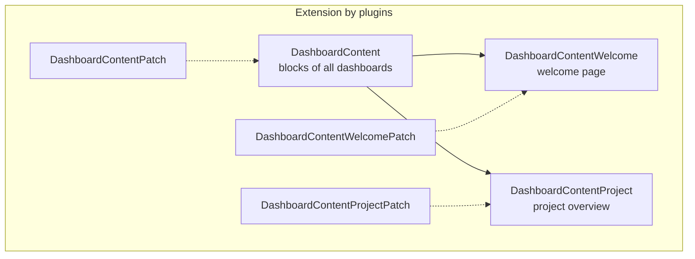

# Dashboard Development Guide

The dashboards of `additionals` replace the welcome page and the project overview of Redmine with layouts of blocks. Most plugins add blocks; new dashboard types are rarely needed. Charts in blocks are described in the [Chart Development Guide](charts.md).



## Dashboards

### Types

| Type | Class | Project | Blocks of additionals | Default layout |
| ---- | ----- | ------- | --------------------- | -------------- |
| `WelcomeDashboard` | `DashboardContentWelcome` | always `nil`, set by `dashboard_type_check` | `welcome`, `activity`, `legacy_left`, `legacy_right` | left: `welcome`, `legacy_left`; right: `legacy_right` |
| `ProjectDashboard` | `DashboardContentProject` | a project, or `nil` for all projects | `projectinformation`, `projectissues`, `projecttimeentries`, `projectmembers`, `projectsubprojects`, `legacy_left`, `legacy_right` | left: `projectinformation`, `projectissues`, `projecttimeentries`; right: `projectmembers`, `projectsubprojects` |

Blocks available on both types (news, documents, queries, feeds, text, ...) are defined in `DashboardContent`.

### System Defaults

A system default is the dashboard a user gets without a choice of their own. Which dashboard a page shows (`Dashboard.default`):

1. the dashboard the user used recently
2. the system default of the project (`system_default: true`, `project_id` set)
3. the global system default (`system_default: true`, `project_id: nil`)
4. a dashboard of the user

| Dashboard | Number allowed | Deletable |
| --------- | -------------- | --------- |
| Welcome system default | one | no |
| Global project system default (`project_id: nil`) | one | no, it is the fallback of every project |
| Project system default (`project_id` set) | one per project | yes |
| Any other dashboard | any | yes, if the user may edit it |

Rules enforced by the model:

- A system default is public (`VISIBILITY_PUBLIC`); dashboards are private, for roles or public.
- Marking a dashboard as system default unsets the other system defaults of its type, for project dashboards of the same project (`update_system_defaults`).
- A system default cannot turn back into a regular dashboard (`SystemDefaultChangeException`), the global project system default cannot get a project (`ProjectSystemDefaultChangeException`, see `project_id_can_change?`).
- Deleting a locked dashboard or one that is not `deletable?` raises an error (`before_destroy`). Dashboards of a project are destroyed with it, the global ones stay.

## Blocks

### Registering a Block

A plugin adds blocks by prepending to `block_definitions` of `DashboardContent` (all dashboards), `DashboardContentWelcome` or `DashboardContentProject`. Always start from `super`, otherwise the blocks of all other plugins disappear:

```ruby
module MyPlugin
  module Patches
    module DashboardContentPatch
      extend ActiveSupport::Concern

      included do
        prepend InstanceOverwriteMethods
      end

      module InstanceOverwriteMethods
        def block_definitions
          blocks = super

          blocks['my_block'] = { label: l(:label_my_block),
                                 permission: :view_issues,
                                 no_settings: true,
                                 partial: 'dashboards/blocks/my_block' }
          blocks
        end
      end
    end
  end
end
```

Register the patch like every other patch of the plugin, e.g. with `loader.add_patch 'DashboardContent'` of `redmine_plugin_kit`. The block then appears in the block selection; its partial renders below the title bar of the dashboard.

### Locals of a Block View

| Local | Content |
| ----- | ------- |
| `dashboard` | the dashboard |
| `block` | id of the block, e.g. `my_block` or `my_block__2` for a second one |
| `block_definition` | the definition hash of the block |
| `settings` | the stored settings of the block (symbol keys) |
| `async` | the async configuration (async blocks only) |
| `@project` | the project, `nil` on the welcome page |

### Settings

A block with settings names a `settings_partial` and declares its settings, so saving them validates and casts them (see [Declared Settings](#declared-settings)):

```ruby
blocks['my_block'] = { label: l(:label_my_block),
                       permission: :view_issues,
                       partial: 'dashboards/blocks/my_block',
                       settings_partial: 'dashboards/blocks/my_block_settings',
                       settings: { title: DashboardContent::TITLE_SETTING,
                                   max_entries: DashboardContent::MAX_ENTRIES_SETTING,
                                   show_closed: { type: :boolean, label: :label_show_closed } } }
```

The fields of the settings partial are named `settings[<block>][<key>]`. The helpers of additionals build them with label and value:

```slim
.box.tabular.settings
  p = additionals_settings_textfield :title, value: settings[:title], tag_name: "settings[#{block}][title]"
  p = additionals_settings_numberfield :max_entries, value: settings[:max_entries], tag_name: "settings[#{block}][max_entries]",
                                                     min: 1, max: 100
  p = additionals_settings_checkbox :show_closed, active_value: settings[:show_closed], tag_name: "settings[#{block}][show_closed]"
```

Read boolean settings with `RedminePluginKit.true?`: a checkbox sends `"0"`, which is truthy in Ruby.

### Declared Settings

A block declares its settings with `settings`, in the format of [`Additionals::SettingsSchema`](settings-schema.md). Saving them (`Dashboard#update_block_settings`) then drops unknown keys and stores nothing if a value is invalid; the settings form shows the errors. Query list blocks with the settings form of additionals get their settings automatically, blocks with `no_settings` drop every setting. Blocks without `settings` keep whatever they get.

Saving runs in this order: `settings_filter` on the given settings, then the declared settings on them, completed by the stored ones. Only given values are checked against their values and bounds, stored ones only for required settings: a query the editor cannot see or a column removed since does not lock the block. A program may send a part of the settings.

`DashboardContent#available_block_schemas` lists the blocks the user can add with `label`, `max_occurs` and their described settings, `#block_settings(block, values:)` returns the schema of one block.

### Async Blocks

An async block renders an empty frame first and loads its content with a request of its own, so a slow block does not hold up the page:

```ruby
blocks['my_block'] = { label: l(:label_my_block),
                       permission: :view_issues,
                       settings_partial: 'dashboards/blocks/my_block_settings',
                       async: { partial: 'dashboards/blocks/my_block',
                                cache_expires_in: 600,
                                required_settings: %i[query_id],
                                libraries: %i[chartjs_meta],
                                lazy: true } }
```

The partial wraps its content in `dashboard_async_cache dashboard, block, async, settings do ... end`, which caches it under a key of the block, its settings and the user.

**Why the cache expires by time.** Async blocks expire after `cache_expires_in` on purpose, they are not invalidated when data changes. What a block shows depends on much more than its main records: a query block also reflects time entries, journals, custom field values, memberships and permissions. Change-based invalidation would have to know all of these sources, and a missed one would leave a block wrong until the cache expires. A short TTL is wrong for seconds at most, wherever a change comes from, and returning from an entry edited via the context menu of a query list block drops the cached block.

`unique_params` is the cheap way to react to changes: each value becomes part of the cache key, so a new value leads to a new entry. Use values from indexed columns, because they are evaluated on every request. `MAX(updated_on)` of a table without an index on that column reads the whole table, e.g. `issues` in Redmine core.

**Why lazy loading is opt-in.** `lazy: true` loads a block when it scrolls into view. It is not the default because blocks with auto refresh must poll regardless of the viewport, toggled blocks load on a click, lazy blocks outside the viewport are missing from a printout, and without a placeholder of the final height (`data_check_class`, see the [Chart Development Guide](charts.md)) all placeholders lie in view at once and nothing is saved. Query list blocks are lazy, they render the largest data sets.

### Query List Blocks

A block listing the entries of a saved query sets `query_block`; additionals provides the partials, settings (query, columns, sort, number of entries) and async loading:

```ruby
blocks['my_entries'] = { label: l(:label_my_entries),
                         permission: :view_my_entries,
                         query_block: { label: l(:label_my_entries),
                                        list_partial: 'my_entries/list',
                                        class: MyEntryQuery,
                                        link_helper: '_project_my_entries_path',
                                        entities_var: :entries,
                                        with_project: true },
                         max_occurs: DashboardContent::MAX_MULTIPLE_OCCURS }
```

### Block Options

| Option | Content |
| ------ | ------- |
| `label` | name in the block selection |
| `permission` | permission(s) the user needs, a symbol or an array |
| `admin_only` | block for administrators only |
| `if` | `proc { \|project\| ... }`, the block is offered only if it returns true |
| `partial` | view of a synchronous block |
| `async` | async loading, see below |
| `no_settings` | the block has no settings, stored ones are dropped |
| `settings_partial` | form of the settings |
| `with_settings_if` | `proc { \|project\| ... }`, the settings form is offered only if it returns true |
| `settings` | declared settings, see [Declared Settings](#declared-settings) |
| `settings_filter` | `proc { \|settings, dashboard\| ... }`, called before saving, returns the settings to keep (e.g. drops those the user may not change) |
| `max_occurs` | how often the block may be added, e.g. `DashboardContent::MAX_MULTIPLE_OCCURS` |
| `libraries` | JavaScript libraries the block needs (`additionals_library_load` keys); also allowed under `async` |
| `query_block` | list of a saved query, see [Query List Blocks](#query-list-blocks) |
| `query_chart` | chart of a saved query, set by `AdditionalsQueryChart.dashboard_block` |

A plugin may add options of its own and read them from `block_definition` in its views.

| `async` option | Content |
| -------------- | ------- |
| `partial` | view rendered by the async request (required) |
| `cache_expires_in` | lifetime of the cached content in seconds |
| `unique_params` | further values of the cache key, from indexed columns |
| `required_settings` | settings without which the block shows nothing; an array or `->(settings) { ... }` for one of several |
| `skip_user_id` | the same content for all users, e.g. a feed |
| `lazy` | load when the block scrolls into view |
| `data_check_class` | class (or class name) with `chart_data_present?(project:)`: with data, the placeholder of a lazy chart gets the height of a chart |
| `min_height` | height of the placeholder in pixels, or `->(project, settings) { ... }` |
| `libraries` | JavaScript libraries the content needs |

Libraries are loaded with the page, for every block in the layout and, if the layout is editable, for every block that can be added: a block added without reloading the page cannot load them itself.

### Assigning a Layout

`Dashboard#assign_layout` sets all groups at once, e.g. for a program building a dashboard:

```ruby
result = dashboard.assign_layout 'top' => [{ block: 'feed', settings: { url: 'https://example.org/feed' } }],
                                 'left' => %w[news feed__2]
result.success? # then dashboard.save
result.errors   # => { 'feed' => { max_entries: ['must be less than or equal to 100'] }, 'news' => { base: [...] } }
result.ignored  # => { 'feed' => [:chart] }, unknown keys that were dropped
```

Entries are block ids (`feed`, `feed__2`). A block without `settings` keeps its stored settings and is not validated, like a block added with `add_block`; given settings replace the stored ones and are validated completely. Every block is checked like `add_block` does (availability, permission, `max_occurs`, no duplicates); with any error nothing changes. Locked dashboards and dashboards the user may not edit return an error under `:base`.

A project dashboard without an own project (a system default) offers what depends on the project, e.g. its queries, only after `content_project` is set, before the first call of `assign_layout` or `content`.

### Replacing Blocks in a Migration

A migration that replaces blocks of existing dashboards uses `Additionals::DashboardBlockReplacer`: it calls a block for every dashboard block and puts the returned blocks in its place, numbered like `DashboardContent#block_options`. Block ids may carry a suffix (`my_block__2`); compare the id without it.

## Testing

- Fixtures need a global system default for both types; regular dashboards have `system_default: false`.
- Destroying a project destroys its dashboards; a global system default linked to a project by mistake would be destroyed with it.
- Blocks of other plugins appear only when those plugins are installed. Tests of additionals run without them.

## Pitfalls

| Symptom | Cause |
| ------- | ----- |
| Blocks of other plugins are missing | `block_definitions` started from `{}` instead of `super` |
| `RuntimeError: It is not allowed to delete dashboard, which is system default` | the global system default cannot be deleted |
| `ProjectSystemDefaultChangeException` | the global project system default cannot get a project |
| A welcome dashboard loses its project | welcome dashboards are always global |
| A block shows old data | the cache lives until `cache_expires_in`; add a cheap `unique_params` value if a change must show at once |
| A boolean setting cannot be switched off | the checkbox value `"0"` read without `RedminePluginKit.true?` |

## References

- `app/models/dashboard.rb`: dashboards, system defaults, layout, settings
- `app/models/dashboard_content.rb`, `dashboard_content_welcome.rb`, `dashboard_content_project.rb`: blocks per type
- `app/helpers/dashboards_helper.rb`: rendering, async options, libraries
- [additional_tags](https://github.com/alphanodes/additional_tags): a public plugin adding dashboard blocks
