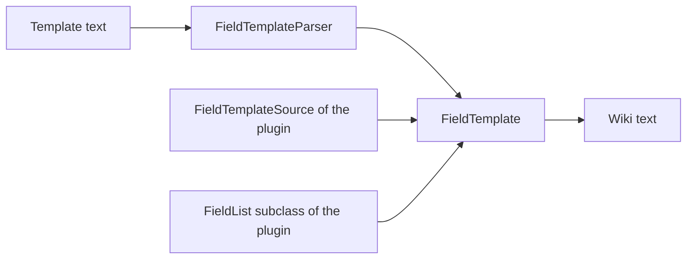

# Field Templates

A field template renders a record as a line of text: `[ ()]`. List macros use it to print one line per record, a plugin may use it for any other text built from field values (a display name, for example). The language lives in additionals so that every macro speaks it the same way; what a placeholder means for a record is up to the plugin.



## Using It in a Plugin

A source describes what a template may know about a record beyond its custom fields:

```ruby
class ServerTemplateSource < Additionals::FieldTemplateSource
  PLACEHOLDERS = { 'name' => :field_name, 'id' => 'ID' }.freeze

  def initialize(server_type)
    super()
    @server_type = server_type
  end

  def placeholders = PLACEHOLDERS
  def custom_fields = @server_type.custom_fields

  def attribute_value(server, name)
    case name
    when 'name' then server.name.to_s
    when 'id' then server.id.to_s
    else super
    end
  end
end

Additionals::FieldTemplate.new(ServerTemplateSource.new(type), escape_macros: true).render template, server
```

| Method | Purpose |
| --- | --- |
| `placeholders` | Names allowed in this template, with their labels (locale key or text) |
| `reserved_placeholders` | All names which do not mean a custom field; a reserved name not allowed here is refused instead of being read as a field |
| `custom_fields` | Fields a placeholder may name, by name or `cf_ID` |
| `attribute_value` | Printed value of a name, a string or an array |
| `condition_value` | Value a condition compares with, where it differs from the printed one (a status key instead of its translated label) |
| `placeholder_enabled?` | `false` lets a name print nothing, e.g. a field turned off for this kind of record |
| `readable` | Label of a referenced record known by something else than its name |
| `field_readable?` | `false` for a custom field the reader may not see: it prints nothing and counts as empty in a condition |

Two templates of the same record with different placeholders (a short name and a longer line) are two sources over the same record.

A list macro subclasses `Additionals::FieldList`, passes the arguments, the block of the macro and the project to `super`, and implements `reserved_options`, `records` (the visible, filtered scope), `default_template`, `block_language`, `renderer`, `available_fields` (only the fields the reader may see: filters and sort read them, a hidden field must stay unknown there) and `default_sort_value`, optionally `sort_attributes`. Arguments, the limit of 500 records, the sort and the numbers of a numbered list come from the base class. A filter argument is a `Filter` of name, operator (`=`, `!=`, `~`, `!~`) and values (separated by `|`, any is enough); `filter_by_custom_field` applies one to a custom field, `apply_filter` is the frame for any other value (tags, for example). The sort option names a custom field or one of the `sort_attributes` of the subclass, `-` sorts descending; a list field sorts by the order of its values, a reference field by the name it shows, text naturally and without regard to case (also without `sort`), empty values go last. An unknown sort field is reported before the records are read, an option given twice is an error. Filters compare through `Redmine::Database.like`, so on PostgreSQL with `unaccent` they ignore accents as well as case, unlike a condition of the template, which only ignores case. In markdown, a line which is no list item, heading or html line ends with a hard break, so every record keeps a line of its own.

Before the lines are rendered, `preload_references` loads the records of every reference field the template names (users, versions, wiki pages, ...) once for all records, instead of one query per value as the field format does. The macro renders the list with the view helper `render_field_list list, obj, css_class:`, which formats the lines, shows "No data to display" and the notice of an unavailable template page.

### Template Pages

Every list understands `template=PAGE`, so many pages share one template. The page is resolved like a core wiki link (`project:Page` for another wiki) and has to be visible to the reader, otherwise the macro shows the same notice for a missing and a hidden page. `FieldTemplateBlock` reads the template from the one code block of the page whose language is `block_language`, a fence in CommonMark, `<pre><code class="...">` in Textile; a second block is an error. The template of a line is the block of the macro, then the template page, then `default_template`.

A line may hold a list again. `render_field_list` refuses a template page which is being rendered already, like the core `include` macro, and nesting deeper than three lists; the limit of 500 records is shared by a list and the lists in its lines and checked before a nested list reads its records. In Textile the mark of a numbered list is a `%...%` span, as Textile escapes html. A plugin checks a template block when a page is saved; `FieldTemplate.check_syntax` covers what holds for every list (brackets, conditions, functions), the placeholders need the fields of the list.

Errors are `Additionals::LocalizedError`: they carry a locale key and its parameters, and `to_s` builds the sentence in the language of whoever reads it. A test names the case by `error.key` without knowing the language.

## Language

| Syntax | Meaning |
| --- | --- |
| ``, ``, `` | Value of an attribute or a custom field (by name or id), case insensitive |
| `[ ... ]` | Optional part: dropped when none of its placeholders has a value; may be nested |
| `` | Condition: prints nothing, keeps its part only if the field has a value |
| ``, `=none`, `=any` | Condition on a value, on an empty or on a filled field |
| ``, `~Text`, `!~Text`, `=A\|B` | Without the value (an empty field included), containing a text or not, one of several values |
| `` | The values which are there, with the separator between them |
| `[text](target)` | A markdown link, not an optional part |
| `.` and a space at the start | The value is the number of the line, see below |

## Design Decisions

### Wiki text, not HTML

A list renders wiki text which the macro runs through the formatter once, like the core macro `collapse`. Only that way wiki syntax and macros work in a template, and the plugin needs to know nothing about the content. With `escape_macros: true`, which a list always uses, values from fields are escaped before (`{{` becomes `!{{`), otherwise a macro call stored in a field would run with the rights of the reader, and a self reference would recurse. The template itself comes from someone who may write macros.

### A number of its own is not a markdown list marker

A line beginning with a placeholder and a dot carries the number of its record. As wiki text `38. Name` is a list marker: CommonMark takes the first number as start value and counts on its own, showing start value plus position instead of the stored number. `FieldList` therefore writes the number as an element (`- <span>38. </span>...`) and labels the finished list in `mark_list`:

- `ul`, not `ol` with `<li value>`: a generated marker can be neither found nor copied, and `<ol type="none">` hides the counter in Firefox only.
- `type="none"` instead of a class alone: the PDF export knows no stylesheet but reads the attribute.
- A hanging indent, not flexbox: flex makes every inline element of a line a column of its own.

The list carries the class `additionals-list-marks`, its width the variable `--a-list-mark-width` (the longest mark of the list in `ch`), which a theme may use.

Only the template tree can tell a number from a placeholder from a fixed `1.` somebody wrote to have the list counted, so the decision is taken there and not on the rendered text.

### Form and meaning are separate

`FieldTemplateParser` turns a template into a tree of text, placeholders, functions and parts and does not know what a name means; `FieldTemplate` walks the tree and asks the source. A syntax error is raised where it stands, a template is parsed once per renderer and reused for every record, and the rule of a part works on what is left after its inner parts were dropped. Unbalanced brackets are text as typed.

### Conditions and values follow different rules

Every condition of a part has to be met, while of the printing placeholders one with a value is enough. Otherwise a filled field would keep a part alive whose condition is not met, which is the very combination a condition on a value is written for. An OR across conditions is written as several parts. `none` is read before the check for an empty value, because it is met by the absence of one.

### A condition compares the stored value

`` compares what a custom field stores, not what it prints: a reference holds an id, a yes/no field `0` or `1`, a date the database format. A template would otherwise depend on the date format or the language of the reader. Attributes compare their printed value unless the source names a key in `condition_value`.
