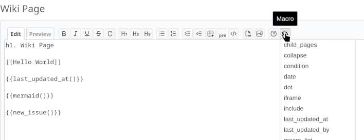
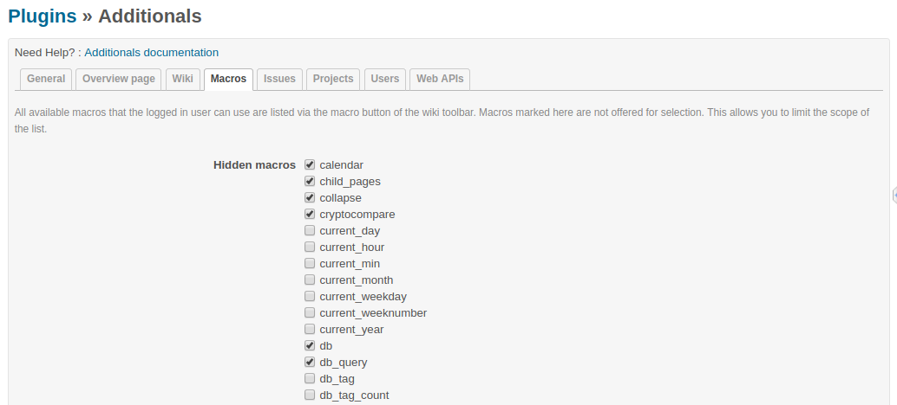
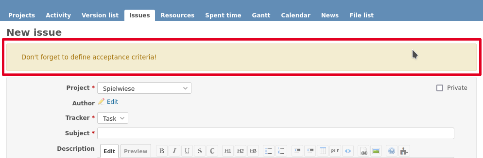
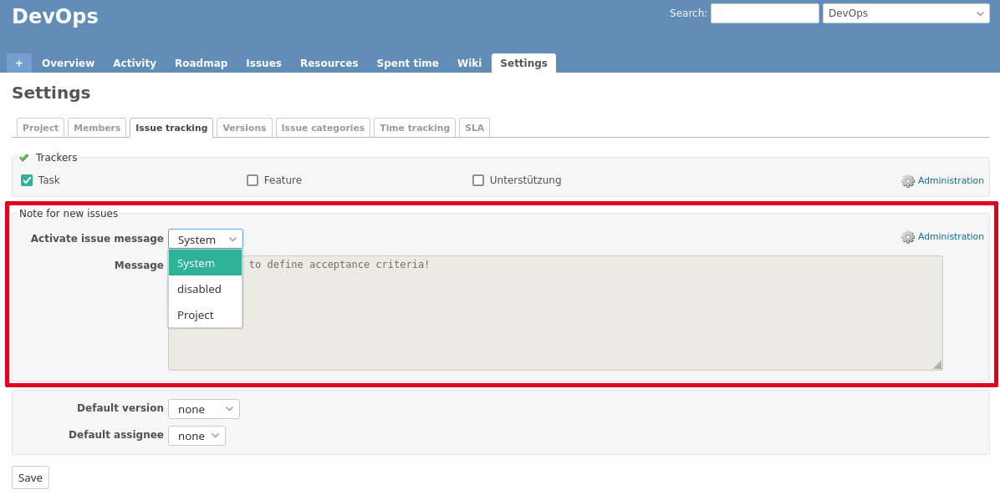
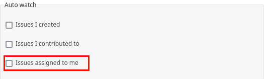
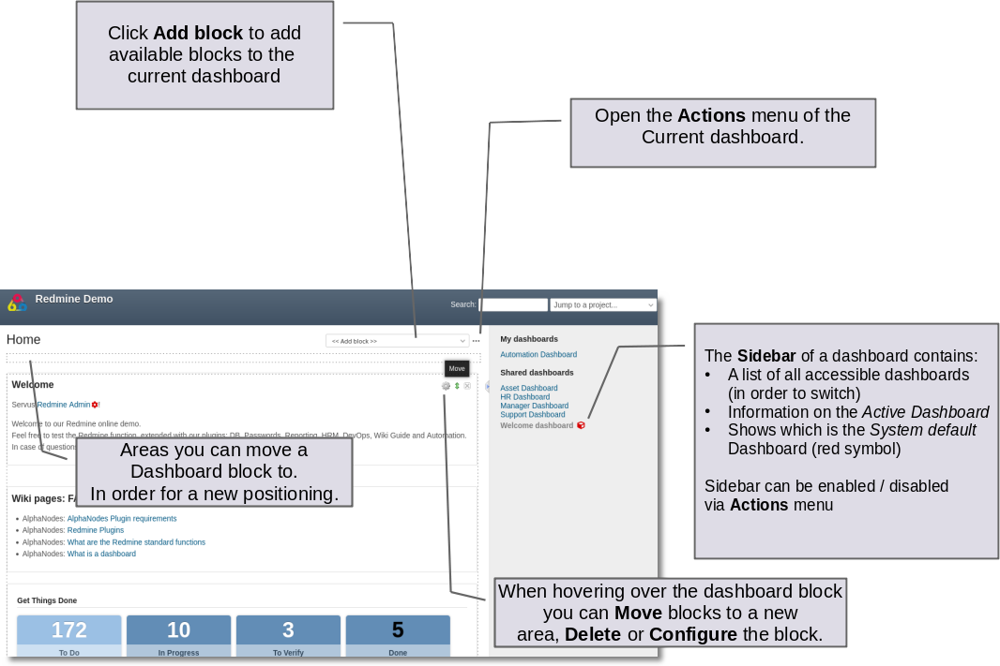
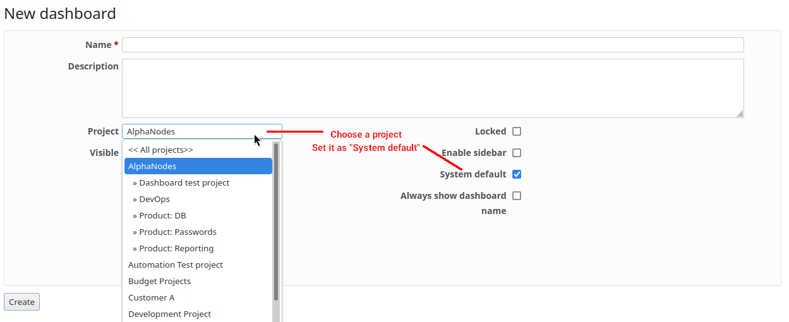

# Additionals Manual

This manual describes the functions of `additionals` from the user interface. Installation and requirements are in the [README](../README.md), developer topics in the [Dashboard Development Guide](dashboards.md), the [Chart Development Guide](charts.md) and the [Settings Schema](settings-schema.md).

The plugin is configured by administrators under _Administration / Plugins / Additionals_. The settings are divided into the tabs described below.

## General

### Contents

All texts accept wiki syntax and macros. Only use content every user may see.

* **Text for login page**: short information below the login form, e.g. whom to contact for an account.
* **Global sidebar**: content shown in the sidebar of all pages.
* **Project wide footer**: content shown at the bottom of all pages, e.g. company information or an imprint.

### Settings

* **Open external URLs**: opens external links in a new browser tab.
* **Add "Go to top" link**: adds a link back to the top of long pages.
* **Emoji support**: converts emoji codes like `:smile:` into emojis.
* **Legacy smiley support**: converts smiley codes like `:)` into icons. Leave it off if another plugin already does this. Available codes: `:)`, `=)`, `:D`, `=D`, `:'(`, `:(`, `;)`, `:P`, `:O`, `:/`, `:S`, `:|`, `:X`, `:*`, `O:)`, `>:)`, `B)`, `(!)`, `(?)`, `(v)`, `(x)` and `(/)`.
* **Global search**: a search dialog (Cmd+K or Ctrl+K) on all pages that jumps to issues by ID, searches in titles, in all or bookmarked projects and remembers recent searches and projects. If no word has at least 3 letters or digits in a row, only titles are searched, so the dialog stays fast on large instances. Other plugins can add their own results.
* **Remove "Help" from top menu**: hides the help menu (see [Help menu](#help-menu)).
* **Maximum number of LiveSearch results**: limits the results of the live search in lists of plugins that support it.

> **Note:** Restart the application server after changing _Open external URLs_ or _Legacy smiley support_.

### Disabled modules

Selected modules are hidden in the project settings, so project managers cannot enable them, even if they are enabled in the global settings. Projects that already use such a module keep it until their project settings are saved again.

## Wiki

* **Global wiki sidebar**: content shown in the sidebar of all wiki pages, e.g. a page tree or the `last_updated_at` and `last_updated_by` macros. Readers only see what their permissions allow.
* **Remove Wiki title from PDF view**: the PDF export of a wiki page leaves out the wiki title in the page header.
* **Remove attachments from PDF view**: the PDF export of a wiki page leaves out its attachments.

## Macros

`additionals` provides these wiki macros:

| Macro | Purpose |
| ----- | ------- |
| `asciinema` | Embed an asciinema recording |
| `attachment_link` | Link to an attachment |
| `cryptocompare` | Show a CryptoCompare widget |
| `date` | Show the current or a given date |
| `tabler` (alias `fa`) | Show an icon of the Tabler icon set |
| `gist` | Embed a GitHub gist |
| `gmap` | Embed a Google map (needs an API key, see [Web APIs](#web-apis)) |
| `google_docs` | Embed a Google document |
| `gps` | Show GPS coordinates with links to OpenStreetMap and Google Maps |
| `group_users` | List the users of a group |
| `iframe` | Embed a web page |
| `last_updated_at` | Show when the wiki page was last updated |
| `last_updated_by` | Show who last updated the wiki page |
| `members` | List the members of a project |
| `meteoblue` | Embed a weather forecast |
| `new_issue` | Link to a new issue form |
| `projects` | List the projects of the current user as a tree |
| `recently_updated` | List recently updated wiki pages |
| `reddit` | Link to a subreddit or user |
| `redmine_issue` | Link to an issue on redmine.org |
| `redmine_wiki` | Link to a wiki page on redmine.org |
| `slideshare` | Embed a SlideShare presentation |
| `twitter` | Link to a Twitter profile or hashtag |
| `user` | Link to a user |
| `vimeo` | Embed or link a Vimeo video |
| `youtube` | Embed or link a YouTube video |

The help page `/help/macros` lists all macros of Redmine and of all installed plugins with their documentation.

### Macro button for the wiki toolbar

The macro button in the wiki toolbar lists the macros a user can use at that place and inserts the selected one at the cursor position. The list only contains macros

* that work in the current area (e.g. wiki-only macros are not offered in issues),
* that the user may use with their roles in the project,
* of modules enabled in the project.

The tab _Macros_ hides selected macros from the button. Hidden macros still work when typed. If all macros are hidden, the button disappears.

## Issues

### Display and shortcuts

* **Note for new issues**: a text shown above the form of new issues, e.g. a link to guidelines. Projects can replace or disable it (see [Project settings](#project-settings)).

  

* **Show max. files**: collapses the attachments of an issue if there are more than the given number.
* **New issue on user profile**: adds a _New issue_ link to user profiles to create an issue for that user.
* **Show "Assign to me" on issue**: adds an _Assign to me_ link to the issue page for project members.
* **Show issue author with note**: marks notes written by the issue author.
* **Fast edit for description**: adds an _Edit_ link to the description, to change only the description.
* **Issue status on sidebar**: lists the allowed statuses in the sidebar of an issue, one click changes the status.
* **Link category**: links the category on the issue page and in issue lists to the issue list of the project filtered by this category.

These options respect the permissions of the roles (view, add, edit issues).

### Issue rules

* **Disallow editing of closed issues (Freeze)**: closed issues can no longer be edited or commented on. Roles with the permission _Edit closed issues_ still can.
* **Author on status change**: if the assignee is unchanged and the status changes from x to y, the issue is assigned to its author. Example: back to the author for _Approval_.
* **Status only for assignee**: status x is only allowed if the current user is the assignee. Together with _Issue status on sidebar_, changing to status x assigns the issue to the current user. Example: only the person working on an issue may set _In Progress_.
* **Automatic assignment to a group**: if an issue has no assignee and gets status x, it is assigned to the first group with users of the selected role. Example: a new issue in status _To Do_ goes to the group of the project managers.
* **Time log for issues required**: issues of the selected trackers need logged time before they get one of the selected statuses. Not required if the user cannot log time or has the permission _Time logging not required_.

Administrators are not bound to these rules.

## Web APIs

* **Google Maps Embed API Key**: required for the `gmap` macro.

## Help menu

The help icon in the top menu opens a menu with links to the Redmine guide and the macro list, for administrators also to the Redmine changelog and the security advisories. Installed plugins can add links to their documentation. The setting _Remove "Help" from top menu_ hides it.

## Project settings

The tab _Issue tracking_ of the project settings decides about the _Note for new issues_ of this project:

| Option   | Effect                                         |
| -------- | ---------------------------------------------- |
| System   | The text of the plugin settings is shown       |
| Disabled | No note is shown                               |
| Project  | A text of this project replaces the global one |

## My account

The auto-watch preferences offer **Issues assigned to me**: you become a watcher of issues assigned to you and keep getting notified when they are later assigned to someone else.

## Roles and permissions

### Role option

* **Hide**: members of this role are not listed in the member box of the project overview and in related lists (e.g. issues, spent time). Users with a role that may see hidden roles still see them.

### Permissions

| Permission | Module | Effect |
| ---------- | ------ | ------ |
| Show hidden roles | Project | See members of hidden roles. Applies across all projects of the user. |
| Save dashboards | Project | Add, edit and delete own dashboards. |
| Set system dashboards | Project | Make dashboards visible for others and the system default (needs _Save dashboards_). |
| Share dashboards | Project | Assign dashboards to other authors (needs _Save dashboards_). |
| Edit issue author | Issue tracking | Change the author of an issue in edit mode. The change is recorded in the history. |
| Set author of new issues | Issue tracking | Set another author when creating an issue. Not recorded in the history, grant it with care. |
| Edit closed issues | Issue tracking | Edit closed issues while _Freeze_ is active. |
| Time logging not required | Issue tracking | Exempt from _Time log for issues required_. |

## Dashboards

Dashboards replace the Redmine home page and the project overview with layouts of blocks that are arranged by drag and drop. Plugins can add dashboards for their own pages and blocks of their own.

With dashboards you can

* show the information relevant to you at a glance,
* create private dashboards and switch between them,
* provide dashboards for other users, roles or everyone.

A dashboard has these options:

* **Visible**: to me only, to any users or to users of selected roles.
* **System default**: the dashboard shown by default. There is one for the home page, one for all project overviews and optionally one per project (_Project default_).
* **Always show dashboard name**: shows the name in the page title also for the system default.
* **Enable sidebar**: shows the sidebar next to the dashboard.
* **Locked**: protects the dashboard against changes and deletion until it is unlocked.

Users need the dashboard permissions (see [Roles and permissions](#roles-and-permissions)) to create or change dashboards. What a block shows always depends on the permissions of the viewer.

### Blocks

Blocks for all dashboards:

| Block | Content | Per dashboard |
| ----- | ------- | ------------- |
| Issues (query) | Issues of a saved query, with selectable columns | 8 |
| Text | Text with wiki syntax | 8 |
| Text (asynchronous) | Text loaded after the page, for macros with much content | 8 |
| Latest news | Latest news, optionally of subprojects | 1 |
| Documents | Latest documents | 1 |
| My spent time | Spent time of the last days | 1 |
| Atom+RSS Feed | Entries of a feed | 20 |
| Standard content left / right | Content other plugins add to the classic page | 1 |

Only on the home page:

| Block | Content |
| ----- | ------- |
| Activity | Latest activity, optionally only your own |
| Welcome | The welcome text of the Redmine settings |

Only on project overviews:

| Block | Content |
| ----- | ------- |
| Project information | Description, homepage and custom fields of the project |
| Issue summary | Issues per tracker |
| Time tracking | Spent time of the project |
| Members | Project members, respecting hidden roles |
| Subprojects | Subprojects of the project |

Other plugins add blocks of their own, e.g. query lists and charts of their entities.

Blocks that load after the page are cached: 30 seconds by default, feeds 10 minutes, issue blocks longer the more open issues there are.

### Default dashboards

New installations get a default dashboard for the home page (Welcome, Standard content left and right) and one for project overviews (Project information, Issue summary, Time tracking, Members, Subprojects). There is no restore function: to start over, create a new dashboard with these blocks and make it the system default.

### FAQ

#### How do I protect a dashboard against accidental changes?

Enable _Locked_. A lock icon shows the state, unlock it to make changes. Work with administrator rights only when you want to change dashboards.

#### How do I set a default dashboard for one project?

Open the dashboard in the project, select the project in its options and enable _System default_.

#### Can anonymous users and non members see other dashboards than employees?

Anonymous users and non members see the system default dashboard and cannot switch. Create further dashboards visible to the roles of your employees, they can switch to them in the sidebar.

#### What happens to the pages when the plugin is uninstalled?

The home page and project overviews show the standard Redmine content again.

A German dashboard manual is available at <https://alphanodes.com/de/redmine-dashboards>.
