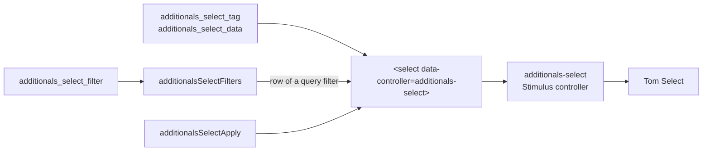

# Select Fields

Select fields with search, entries from the server, tags and multiple values all go through `additionals`. A view renders a `<select>` with the Stimulus controller `additionals-select`, which sets the field up in the browser. Plugins never talk to the library behind the fields (Tom Select): its calls, events and CSS classes are known to `additionals` only, so an update or a switch of the library stays a change in `additionals`.



## Helpers

`additionals_select_tag(name, option_tags = nil, **options)` renders the select and loads the library. All options of `select_tag` apply, plus the field options below. A multiple select gets no blank option and a hidden field that submits an empty value when nothing is chosen (`include_hidden: false` leaves it out).

```slim
= additionals_select_tag 'issue[tag_list]',
                         options_for_select(tags.map { |tag| [tag, tag] }, tags),
                         multiple: true,
                         url: issue_tags_auto_completes_path(project_id: @project),
                         placeholder: l(:label_add_tags),
                         tags: true,
                         scoped_tags: true
```

`additionals_select_data(data = nil, **field_options)` returns the data attributes for a select of a form builder. Load the library yourself with `additionals_library_load :select_fields`:

```slim
= additionals_library_load :select_fields
= f.select :recipients, options, {}, multiple: true, data: additionals_select_data(url: my_addresses_path, free_input: true)
```

`additionals_icon_select` and `additionals_icon_select_tag` (icon picker) as well as `autocomplete_select_entries` (users, groups and other records) are built on these helpers.

## Field options

| Option | Purpose |
| --- | --- |
| `url` | Entries come from this URL (JSON `[{ id, text, ... }]`, groups as `{ text, children }`, parameter `q` with the search); an entry on top without a group stays there when a group repeats its id, e.g. `<< me >>` of a form field |
| `tags` | Typed text becomes a value of its own; a comma separates values |
| `scoped_tags` | Like `tags`, a tag `group::value` replaces a chosen tag of the same group |
| `free_input` | Typed text becomes a value: offered after the found entries, and taken when the field is left with a click elsewhere or Tab (not after a choice, Enter or Escape), e.g. for mail addresses |
| `free_input_pattern` | Regular expression typed text has to match for `free_input`, in JavaScript syntax (a Ruby `Regexp` passes its source), e.g. `@` |
| `renderer` | How entries look, see below |
| `value_key` | Property of the server entries that becomes the value; entries without it cannot be chosen |
| `placeholder` | Text of the empty field |
| `allow_clear` | Shows a button that empties the field; a single field gets a blank option for it, so the empty value is sent |
| `min_input_length` | Characters to type before searching |
| `width` | Width of the field, default `90%` |

A value changed after the field is set up (e.g. `data-additionals-select-tags-value` set from JavaScript) sets the field up again.

The list offers no blank option, the placeholder stands for it; a field that may be emptied uses `allow_clear`.

## Renderers

The renderers are a fixed list. Text of the server is shown as text; only `name_with_icon` and `avatar` are HTML, which the server builds and escapes.

| Renderer | Entries |
| --- | --- |
| `name_with_icon` | Default: `name_with_icon` of the server, otherwise `text` |
| `avatar` | `avatar` (HTML) in front of `text` |
| `contact` | `avatar`, `text` and `email`; a chosen entry shows `text <email>` |
| `icon` | Icon of the sprite in `data-href` of the option |
| `color_scheme` | A color scheme of Chart.js with its colors |

## Events

| Event | When |
| --- | --- |
| `change` | Native event when the value changes; jQuery handlers, listeners and inline `onchange` get each change once |
| `additionals-select:select` | An entry was chosen, `event.detail.item` is the entry of the server |
| `additionals-select:close` | The list closes |

The order of `additionals-select:close` and `additionals-select:select` is not fixed, so a listener does not depend on it.

## JavaScript API

`window.AdditionalsSelect` works on a `<select>` with the controller:

| Function | Purpose |
| --- | --- |
| `open(select)` | Opens the list |
| `refresh(select)` | Shows a value set from JavaScript (`select.value = ...`, an appended `<option>`) and sends `change` once; any other field just gets `change`. Plugins call it after every value they set, never `.trigger('change')` |
| `destroy(select)` | Removes the field of the library |
| `menu({ anchor, entries, placeholder, onSelect, onClose })` | Opens a list of `entries` (`{ id, text }`) below `anchor` to pick one; it goes away after a choice, with Escape or a click outside |

Every field carries the class `additionals-select-field` for styles that place or size it. Fields in content loaded later (dialogs, `render_async`) are set up as well, also when the library comes with that content. The list hangs at the body, lies above dialogs and follows the field when a container around it scrolls; its search takes the focus in modal dialogs too.

The list opens with a click, Enter or the arrow down, not when the field only gets the focus (e.g. with Tab). Tab on an open list closes it and goes on to the next field, Backspace or Delete empty a closed single field with `allow_clear`. The search of a single field carries the name of the field and the marked entry for screen readers. A field follows its select: options appended or removed, values set and told by `change`, and `disabled`.

## Query filters

Redmine builds the rows of query filters in the browser. `additionals_select_filter` registers a select field for the values of filters, by filter type, by custom field format or by filter name; the name wins over the format, which wins over the type. It takes the field options above, filters choose multiple values unless `multiple: false`. A filter type of a plugin gets the operators of an optional list. A field of a filter row is as wide as its entries, unless the registration gives a `width`. A single field of a filter row without a value chooses nothing, the browser would choose its first entry.

```slim
= additionals_select_filter type: 'author', url: grouped_users_auto_completes_path(project_id: @project)
= additionals_select_filter field_format: 'my_format', url: my_entries_auto_complete_path(project_id: @project)
```

Rows a plugin builds itself in the browser turn their select into a field with `additionalsSelectApply(select, options)`, the options in camelCase as in `additionalsSelectFilters`; `values` names the chosen values when a single select becomes multiple.

Pages for people without access to Redmine (e.g. public pages of a plugin) answer `additionals_select_fields?` with false in their controller; `additionals_select_filter` then renders nothing there.

## Tests

System tests use the helpers of `Additionals::GlobalSystemTestHelper` instead of the markup of the library: `choose_select_entry(container, text, search:, exact:)`, `add_select_tag(container, name)`, `remove_select_entry(container, text)`, `clear_select_field(container)` and `assert_select_chosen(container, *texts)`; for a field or menu opened otherwise `open_select_field(container)`, `type_into_open_select(text_or_key)`, `leave_select_field`, `choose_open_select_entry(text)`, `assert_select_entry(text)` and `assert_no_select_entry(text)`. Only `SELECT_FIELD_MARKUP` in that helper knows the markup of the library.

The JavaScript tests of additionals work a field through the driver `test/javascript/support/select_field.js` (open, type, choose, keys, click elsewhere, read the chosen entries) and check the behavior of this document, not the state of the library.

`assert_select_fields_through_additionals(plugin_id)` in the convention test of a plugin fails for code that uses the library directly: its calls, events and CSS classes, and the former helpers of `additionals`.
